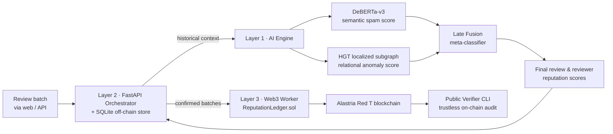

# AI-Based Decentralized Reputation & E-Commerce Fraud Detection Framework

[](https://www.python.org/downloads/)
[](https://pytorch.org/)
[](https://fastapi.tiangolo.com/)
[](https://web3py.readthedocs.io/)
[](https://react.dev/)
[](./LICENSE)

Final Year Project (TFG) — **University of Jaén**, 2025–2026.

A hybrid AI & Blockchain system that detects deceptive e-commerce reviews, fake reviewer recruitment
campaigns, and organized collusion rings. The pipeline combines a fine-tuned **DeBERTa-v3** semantic
scorer, a **Heterogeneous Graph Transformer (HGT)** over the reviewer–review–product network, and a
score-level **late fusion** meta-model — with final reputation scores anchored on the
**Alastria Red T** consortium blockchain for immutable public audits.

## Key Results (chronological test split, zero temporal leakage)

| Stage | Model | Accuracy | ROC-AUC | F1-Macro |
|---|---|---|---|---|
| Semantic | Fine-tuned DeBERTa-v3, threshold 0.70 | 0.798 | 0.831 | 0.735 |
| Graph | HGT (PyTorch Geometric) — review head | **0.916** | 0.965 | 0.894 |
| Graph | HGT — reviewer head | 0.864 | 0.933 | 0.855 |

Full per-model benchmark tables live in `baseline_experiment/*.json`, `HGT_Heterogeneous_Graph_Model/hgt_model_metrics.json`, and `late_Fusion_Score-Level_Integration/model_benchmarks_summary.json`.

> Data is split stratified 80/10/10 into train/val/test; thresholds and model selection use the validation split only, and the test set is scored once. Against the obvious stacking concern — reviewer connections leaking across sets — the graph is built chronologically and neighbor sampling is time-aware, so any prediction only reaches connections that existed *before* it in the review history. Fusion is done at the score level: HGT scores + the DeBERTa text probability (plus a rolling average of the reviewer's past DeBERTa scores) feed LightGBM / Logistic Regression / MLP meta-classifiers.

---

## How It Works



1. **Semantic scoring** — fine-tuned DeBERTa-v3 (`microsoft/deberta-v3-base`) classifies review text (spam vs. genuine) with an optimized decision threshold.
2. **Relational modeling** — an HGT over bipartite/generic `Reviewer ↔ Review ↔ Product` graphs, built chronologically from review history, detects suspicious reviewers and products (e.g., recruitment rings, bimodal rating products).
3. **Late fusion** — the graph scores and the DeBERTa probability (plus a rolling historical average per reviewer) feed LightGBM / XGBoost / Logistic Regression / MLP meta-classifiers, evaluated on the same chronological split.
4. **On-chain anchoring** — confirmed scores are written to the `ReputationLedger.sol` contract deployed on Alastria Red T, and any external auditor can verify a review or a transaction receipt with the public CLI, without access to the internal database.

---

## Web App & Live Alastria Network

This is not just training scripts — it ships as a full production stack:

* **React 19 + Vite + Tailwind web dashboard** (`Deployment/frontend`): a product catalog where each product shows its AI trust score, reviewer profiles with their historical score progression, and a submitter dashboard to send signed review batches.
* **FastAPI orchestrator** (`Deployment/orchestrator`): asynchronous REST API with Swagger documentation, backed by SQLite for off-chain metadata.
* **Solidity smart contract** (`Deployment/ReputationLedger.sol`): deployed on the **live Alastria Red T consortium network** (UJaén node at `sinbad2.ujaen.es:8012`), contract address `0x51EA9c1D046BE57E3B461d9048176800cb3380f5`. A background Web3 worker anchors confirmed reputation scores on-chain, and anyone can audit them externally.

---

## System Architecture & Directory Structure

```text
./
├── Deployment/                              # Production Stack (API, Web3 Worker, Database & Frontend)
│   ├── ai_engine/                           # Singleton AI Model Loader & Feature Engineering Engine
│   ├── database/                            # SQLite Off-Chain Metadata & Initial Setup (`init_db.py`)
│   ├── frontend/                            # React 19 + Vite + Tailwind CSS User Interface
│   ├── orchestrator/                        # FastAPI Asynchronous REST Service & Batch Handlers
│   ├── verifier/                            # Public Read-Only Blockchain Verification CLI Tools
│   ├── web3_worker/                         # Alastria Ledger Background Anchor & Smart Contract Workers
│   └── ReputationLedger.sol                 # Solidity Smart Contract for Immutable On-Chain Storage
├── HGT_Heterogeneous_Graph_Model/           # Relational Graph Neural Network (`PyTorch Geometric`)
├── SpamVis_DeBERTa-v3-base_Model/           # Semantic NLP Scorer (`Transformers` & `best_threshold.json`)
├── late_Fusion_Score-Level_Integration/     # LightGBM / XGBoost Ensemble Training & Threshold Tuning
├── baseline_experiment/                     # Reproducible classic-ML baselines & blending ensemble
├── data/                                    # Public Datasets (`public_reviews_dataset_cleaned.csv`)
├── requirements.txt                         # Pinned Python Package Dependencies (for `pip`)
└── pyproject.toml                           # Project Metadata & Configuration (for `uv`)
```

---

## Experimental Benchmarks & Code Roadmap

This repository is structured around three core empirical experiments evaluated across the academic thesis, along with a live blockchain verification tool. Each experiment corresponds directly to a dedicated directory in the project root:

### 1. Experiment 1: Baseline Machine Learning Classifiers (`./baseline_experiment`)
Contains the complete code for evaluating standard ML baselines on both review-centric text metrics and reviewer-centric behavioral metrics:
* **Text-Centric Baseline Models**: Logistic Regression, Naive Bayes, Random Forest, MLP, XGBoost, and LightGBM over linguistic features (sentiment, readability, capitalization, word embeddings) (`train_text_centric_model.py`).
* **Behavioral-Centric Baseline Models**: Evaluates reviewer metadata anomalies and statistical patterns (`train_behavior_centric_model.py`).
* **Linear Blending Ensemble**: Evaluates optimal score-level blending of text and behavioral predictions (`evaluate_linear_blending_ensemble.py`).

### 2. Experiment 2: Semantic Transformer Fine-Tuning (`./SpamVis_DeBERTa-v3-base_Model`)
Contains the evaluation and inference scripts for the fine-tuned **DeBERTa-v3-base** transformer model (`microsoft/deberta-v3-base`) for advanced semantic fraud detection across the e-commerce dataset (`run_deberta_csv_inference.py`, `evaluate_test_metrics.py`, plus BERT / RoBERTa / DeBERTa training notebooks).

### 3. Experiment 3: Heterogeneous Graph Transformer & Late Fusion (`./HGT_Heterogeneous_Graph_Model` & `./late_Fusion_Score-Level_Integration`)
The culmination of the thesis architecture, capturing complex structural network topologies and fusing them with semantic language representations:
* **`./HGT_Heterogeneous_Graph_Model`**: `build_graph.py` constructs the heterogeneous graph, `train.py` trains the Heterogeneous Graph Transformer via time-aware neighbor sampling, and `export_predictions_csv.py` saves out-of-sample scores for fusion (`model.py`, binary focal loss, best-threshold search).
* **`./late_Fusion_Score-Level_Integration`**: Combines DeBERTa-v3 semantic scores with HGT graph embeddings via gradient-boosting meta-classifiers (`train_late_fusion_models.py`), achieving the best macro F1 and AUC across both reviewer recruitment rings and fake review text.

### 4. Cryptographic Blockchain Ledger Verification (`./Deployment/verifier/public_verifier_cli.py`)
Provides a command-line interface (`public_verifier_cli.py`) that interacts directly with the live **Alastria Red T** decentralized blockchain network (`ReputationLedger.sol`). Independent auditors can cryptographically verify any review reputation score, transaction hash (`0x...`), or mining block confirmation receipt directly on-chain without requiring access to the internal SQLite database.

---

## Public Verification CLI (`public_verifier_cli.py`)

Independent auditors or consumers can verify any score on the blockchain without accessing the local database:

```powershell
# Verify an individual review directly from the smart contract by Review ID (0x...):
uv run python ./Deployment/verifier/public_verifier_cli.py --review-id 0x1234567890abcdef1234567890abcdef

# Verify a mining receipt transaction hash directly on-chain:
uv run python ./Deployment/verifier/public_verifier_cli.py --tx-hash 0xabcdef...
```

---

## Dataset

Sourced from the public benchmark [bretthollenbeck/fake-reviews-data](https://github.com/bretthollenbeck/fake-reviews-data) — a labeled Amazon case study of fake-review rings: **~381,000 reviews**, of which **~80,000** carry usable labels for training and evaluation. The cleaned CSV (~267 MB) goes into `./data/` as `public_reviews_dataset_cleaned.csv` (path expected by every script).

---

## Pre-Trained DeBERTa Model Setup

The core NLP classification engine relies on a fine-tuned DeBERTa-v3 model. Download the pre-trained weights from Google Drive: [https://drive.google.com/file/d/12JV-zwgF8m4ZWuISgzGp5ZsrKqyd9w0c/view?usp=sharing](https://drive.google.com/file/d/12JV-zwgF8m4ZWuISgzGp5ZsrKqyd9w0c/view?usp=sharing)

1. Download the `.zip` file.
2. Extract the downloaded `.zip` file.
3. Place all extracted contents directly into the following folder so the inference script can find them:
   ```text
   ./SpamVis_DeBERTa-v3-base_Model
   ```

---

## Installation & Setup Guide

### 1. Prerequisites Verification (`Node.js` & `uv`)
Before installing the backend dependencies, verify that you have `Node.js` and `npm` installed on your system:
```powershell
node -v
npm -v
```
*(Requires Node.js version `20.x` or higher to manage the React frontend and background process workers).*

Next, ensure you have **`uv`** installed. `uv` is a **Rust-based Python package and virtual environment manager**:
```powershell
# On Windows PowerShell:
powershell -ExecutionPolicy ByPass -c "irm https://astral.sh/uv/install.ps1 | iex"

# On Linux/macOS:
curl -LsSf https://astral.sh/uv/install.sh | sh
```

---

### 2. AI System Setup (`uv sync`)

To initialize the entire AI system, you do not need manual `virtualenv` or `pip install -r requirements.txt` steps. **`uv sync` does everything automatically**: it reads `pyproject.toml`, creates a clean isolated `.venv` virtual environment inside `./`, and downloads the PyTorch, PyG, Transformers, and Web3 libraries.

Run this command directly from the root folder (`./`):
```powershell
uv sync
uv add gensim textstat vaderSentiment nltk transformers>=4.48.0
```

**CRITICAL: Install PyTorch Geometric Hardware Extensions**
Because the Graph Neural Network (HGT) relies on C++ extensions that must match your local hardware (Mac/Apple Silicon, Windows AMD, or NVIDIA CUDA), an automated script is provided.

**Order matters:** run this script *strictly after* `uv sync` finishes. The script uses the PyTorch library installed by `uv sync` to detect your hardware architecture and fetch the matching C++ binaries.
```powershell
uv run python install_pyg.py
```

> **WARNING: Hardware-Dependent Libraries (CUDA Compatibility)**
> Disclaimer: Deep learning libraries such as `torch`, `torchvision`, and the PyTorch Geometric C++ extensions (`pyg-lib`, `torch-scatter`, etc.) depend on your GPU architecture and CUDA version. By default, `pyproject.toml` and `requirements.txt` target **NVIDIA CUDA 12.1** (`+cu121`) acceleration (`https://download.pytorch.org/whl/cu121`). If you are running on a machine without an NVIDIA GPU (such as Apple Silicon Mac, AMD GPU, or pure CPU), you must adjust the PyTorch wheel index URL inside `pyproject.toml` to match your local hardware before running `uv sync` to prevent installation errors (e.g. `WinError 127`).

---

### 3. Frontend UI Setup
To install the package dependencies for the React web interface:
```powershell
cd ./Deployment/frontend
npm install
cd ../..
```

---

## Running the Platform Locally

Once your Python environment (`uv sync`), Node.js environment (`npm install`), and dataset (`./data/public_reviews_dataset_cleaned.csv`) are ready, initialize the database and start the entire platform:

### 1. Initialize & Seed the SQLite Database
Run the initialization script directly from your root directory (`./`):
```powershell
uv run python ./Deployment/database/init_db.py
```

### 2. Launch All Microservices with `server.py` (Master Orchestrator)
Instead of opening separate terminals for the AI Engine, FastAPI Orchestrator, Alastria Web3 Worker, and React UI, use the unified launcher:
```powershell
uv run python ./Deployment/server.py
```
`server.py` boots all four microservice layers (`AI Engine`, `FastAPI Orchestrator on port 8000`, `Alastria Web3 Worker`, and `React UI on port 5173`) in a single terminal with real-time color-coded logging. Press `Ctrl+C` to shut down the entire system at once.

---

### Alternative: Manual Multi-Terminal Launch (If running services individually)

#### A. Start the Backend API & AI Engine (Terminal 1)
```powershell
uv run uvicorn Deployment.orchestrator.main:app --host 0.0.0.0 --port 8000 --reload
```
*API Swagger Documentation will be available at: `http://localhost:8000/docs`*

#### B. Start the React Frontend Dashboard (Terminal 2)
```powershell
cd Deployment/frontend
npm run dev
```
*The web dashboard will open at: `http://localhost:5173`*

### 3. Run the Blockchain Ledger Worker (Optional / Background Daemon)
To process batches of `Confirmed_OffChain` reviews and anchor them immutably to the Alastria Red T smart contract (`ReputationLedger.sol`):
```powershell
# Directly via Python:
uv run python Deployment/web3_worker/alastria_ledger_worker.py

# Or continuously in the background using PM2:
npm install -g pm2
pm2 start ".venv/Scripts/python.exe" --name "alastria-worker" -- Deployment/web3_worker/alastria_ledger_worker.py
```

---

## License

Licensed under the [MIT License](./LICENSE). This repository is a **Final Year Project (TFG, Trabajo de Fin de Grado)** developed at the **University of Jaén** during the 2025–2026 academic year.
